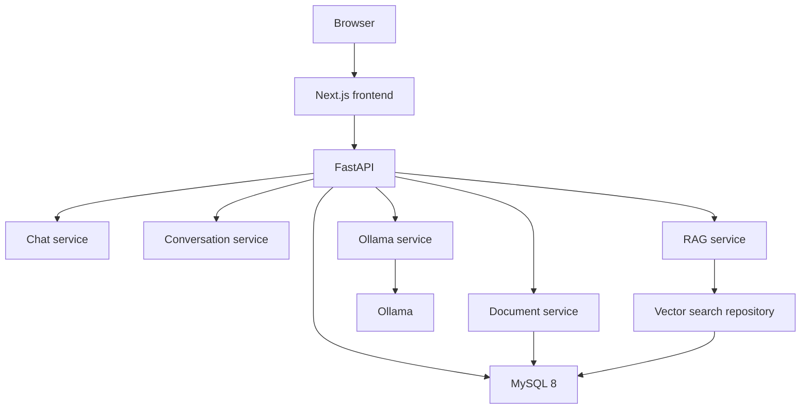

# Local AI Assistant

Status: Phase 4 complete. Phase 5 has not started.

Temporary product name. A final name has not been chosen. This repository was started as `Ai-web-application-5sae11`.

Local AI Assistant will be a local-first web workspace for conversation with a model that runs on the same machine. The interface will be dark, minimal, and developer-oriented. It is inspired by that general feeling, and it will be an original interface. It will not copy another product’s code, branding, logos, or layout.

The API calls local Ollama, stores conversations and messages, and streams chat with that history. File uploads, RAG, and the Next.js interface are not implemented yet.

## Overview

The project will let a person chat with a local model, keep conversation history, upload documents, and ask questions about those documents. Inference and embeddings will run through [Ollama](https://ollama.com). The web app will be a Next.js frontend talking to one FastAPI backend. MySQL 8.x will store users, conversations, messages, documents, and document chunks.

The application will not call OpenAI, Gemini, Claude, or any other cloud language-model API.

## Objectives

- Keep inference on the local machine.
- Provide a focused chat workspace rather than a generic data-entry application.
- Persist conversations and uploaded documents.
- Answer questions about uploaded files through retrieval-augmented generation (RAG).
- Keep vector search behind a repository boundary so the storage approach can change later.
- Stay small enough for a personal or university project: one frontend, one backend, MySQL, and Ollama.

## Features

### Implemented

- Project specification, architecture, and development roadmap (Phase 1).
- Example environment template and repository ignore rules.
- FastAPI application with configuration, logging, error handling, and `GET /api/health` (Phase 2).
- SQLAlchemy models and an Alembic migration for `users`, `conversations`, `messages`, `documents`, and `document_chunks`.
- A health test that does not require MySQL.
- Empty `frontend/` and `storage/uploads/` directories reserved for later phases.

### Planned

- Chat with a local model selected from models installed in Ollama.
- Create, rename, search, and delete conversations.
- Stream model responses.
- Upload PDF, DOCX, TXT, and Markdown files.
- Extract text, chunk it, embed it, and search it.
- Ask questions about uploaded documents.
- Manage document metadata and delete documents.
- Markdown rendering, code blocks, copy, regenerate, and stop generation in the chat UI.

## Technology Stack

### Frontend

- Next.js
- React
- TypeScript
- Tailwind CSS
- shadcn/ui

### Backend

- Python
- FastAPI
- SQLAlchemy
- Pydantic

### AI

- Ollama
- Local chat model
- Local embedding model, also through Ollama

### Database

- MySQL 8.x

### Document processing

- PyMuPDF
- python-docx
- Pillow, only where a future extractor needs image handling

### Infrastructure

- Docker
- Docker Compose

Docker Compose runs MySQL 8. The API and Ollama stay on the host. See [docs/deployment.md](docs/deployment.md).

## Architecture



The browser will talk only to the Next.js application. Next.js will call FastAPI. FastAPI will own chat, conversations, documents, RAG, and the Ollama client. Ollama will run on the host. MySQL will store relational data and, in the planned first vector approach, embedding payloads on chunk rows. Similarity search will go through a repository so the rest of the backend does not depend on how vectors are stored.

Details: [docs/architecture.md](docs/architecture.md).

## Project Structure

```text
.
├── README.md
├── .gitignore
├── .env.example
├── docker-compose.yml          # MySQL 8
├── docs/
│   ├── architecture.md
│   ├── setup.md
│   ├── development.md
│   ├── database.md
│   ├── api.md
│   ├── ai.md
│   ├── rag.md
│   ├── frontend.md
│   ├── backend.md
│   ├── file-processing.md
│   ├── security.md
│   ├── testing.md
│   ├── deployment.md
│   ├── roadmap.md
│   └── decisions/
│       └── README.md
├── frontend/                   # empty until Phase 7
├── backend/                    # FastAPI application (Phase 2)
└── storage/
    └── uploads/                # empty; future upload directory
```

The planned backend layout is documented in [docs/backend.md](docs/backend.md). The Next.js application is not initialized.

## Prerequisites

These tools will be required when later phases start. Installing them is not part of Phase 1, and this repository does not yet check that they are present.

- Node.js
- npm
- Python
- MySQL 8.x
- Ollama
- Git
- Docker

See [docs/setup.md](docs/setup.md).

## Ollama

Ollama will serve both the chat model and the embedding model on the local machine. The application will not hard-code a permanent model. Chat and embedding model names will come from configuration, and the interface will eventually let the user pick an installed chat model.

Example configuration only:

```env
OLLAMA_BASE_URL=http://localhost:11434
OLLAMA_CHAT_MODEL=qwen3:8b
OLLAMA_EMBEDDING_MODEL=nomic-embed-text
```

Any compatible model the user has pulled may be used instead. GPU hardware is not assumed.

## Installation

Status: Backend steps are runnable. The frontend is not created yet. Conversations and chat messages are stored in MySQL. File uploads are not implemented yet.

1. Install the prerequisites in [docs/setup.md](docs/setup.md).
2. Install Ollama, then pull a chat model and an embedding model of your choice.
3. Copy `.env.example` to `.env` and set MySQL credentials and model names.
4. Create the MySQL database named in `DATABASE_URL`.
5. From `backend/`, install dependencies, apply migrations, and start the API on port 8000:

```text
python -m venv .venv
.venv\Scripts\python -m pip install -r requirements.txt
.venv\Scripts\python -m alembic upgrade head
.venv\Scripts\python -m uvicorn app.main:app --reload --port 8000
```

Python 3.11 or newer is required. Every variable in `.env.example` is required at startup. There is no default database password in code. Create the empty MySQL database named in `DATABASE_URL` before `alembic upgrade head`. The application does not create that database.

On macOS or Linux, use `source .venv/bin/activate` and then `pip`, `alembic`, and `uvicorn` directly. `GET http://localhost:8000/api/health` returns `{"status":"ok"}` when the process is up. That response does not check MySQL.

6. In a later phase, install frontend dependencies and run Next.js.

Do not create a `.env` file with real secrets in version control. `.env.example` contains placeholders only.

## Development

Work proceeds one phase at a time. Phase 4 stores conversations and messages. Phase 5 has not started.

| Phase | Focus | State |
| --- | --- | --- |
| 1 | Documentation and architecture | Complete |
| 2 | Backend foundation | Complete |
| 3 | Ollama integration | Complete |
| 4 | Conversations and messages | Complete |
| 5 | File management | Planned |
| 6 | RAG | Planned |
| 7 | Frontend | Planned |
| 8 | UX polish | Planned |
| 9 | Testing | Planned |
| 10 | Security and finalization | Planned |

Full task lists: [docs/development.md](docs/development.md) and [docs/roadmap.md](docs/roadmap.md).

## RAG

When a question depends on an uploaded document, the backend will retrieve relevant chunks and place them in the prompt as document context. The model will still have its own general knowledge. The prompt will separate retrieved passages from the user’s question so answers can be grounded in the file without treating the whole model as a search index.

Pipeline, planned:

```text
Document → extract → clean → chunk → embed → store
Question → embed → similarity search → relevant chunks → prompt → Ollama → answer
```

Details: [docs/rag.md](docs/rag.md).

## Documentation

- [Architecture](docs/architecture.md)
- [Setup](docs/setup.md)
- [Development phases](docs/development.md)
- [Roadmap](docs/roadmap.md)
- [Database](docs/database.md)
- [API](docs/api.md)
- [AI and Ollama](docs/ai.md)
- [RAG](docs/rag.md)
- [Frontend](docs/frontend.md)
- [Backend](docs/backend.md)
- [File processing](docs/file-processing.md)
- [Security](docs/security.md)
- [Testing](docs/testing.md)
- [Deployment](docs/deployment.md)
- [Decision log](docs/decisions/README.md)

## Roadmap

```text
[DONE]    Phase 1 — Documentation and architecture
[DONE]    Phase 2 — Backend foundation
[DONE]    Phase 3 — Ollama
[DONE]    Phase 4 — Conversations
[NEXT]    Phase 5 — Files
          Phase 6 — RAG
          Phase 7 — Frontend
          Phase 8 — UX
          Phase 9 — Testing
          Phase 10 — Security and finalization
```

## Security

The following protections are planned and are not implemented:

- Validate file type and size before storage.
- Sanitize filenames and block path traversal.
- Refuse to execute uploaded files.
- Validate API input with Pydantic.
- Keep database credentials and other secrets in environment variables.
- Restrict local file access to the upload directory.
- Return sanitized errors to the client.

Details: [docs/security.md](docs/security.md).

## Testing

A health-route test lives in `backend/tests` and does not need MySQL. Later phases will add the rest of the backend unit and API tests, document-processing and RAG tests, Ollama and MySQL integration checks, frontend component tests, and an end-to-end chat flow.

Details: [docs/testing.md](docs/testing.md).

## Troubleshooting

Status: `GET /api/health` returns `{"status":"ok"}`. MySQL migrations have been applied to the Docker MySQL 8 instance. `GET /api/models` and `POST /api/chat` call the local Ollama server. The frontend is not created yet.

### Ollama unavailable

Confirm Ollama is running and that `OLLAMA_BASE_URL` matches it (the example is `http://localhost:11434`). A later health check will report this explicitly.

### Model unavailable

The configured chat or embedding model must already be pulled in Ollama. Model names in `.env.example` are examples, not requirements.

### MySQL unavailable

Confirm MySQL 8.x is running, the database exists, and `DATABASE_URL` uses the `mysql+pymysql` scheme with the correct user, password, host, and port. From `backend/`, run `alembic upgrade head`.

### Backend unavailable

Start the API from `backend/` with `uvicorn app.main:app --reload --port 8000` after copying `.env.example` to `.env`. `GET http://localhost:8000/api/health` returns `{"status":"ok"}` when the process is up. That response does not mean MySQL is reachable.

### Frontend unavailable

The Next.js app is not created yet. After Phase 7, the dev server must be running to open the workspace in a browser.
